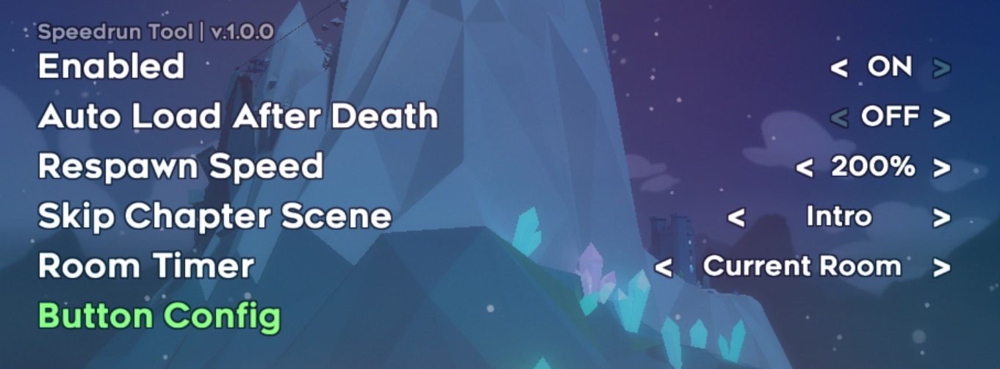
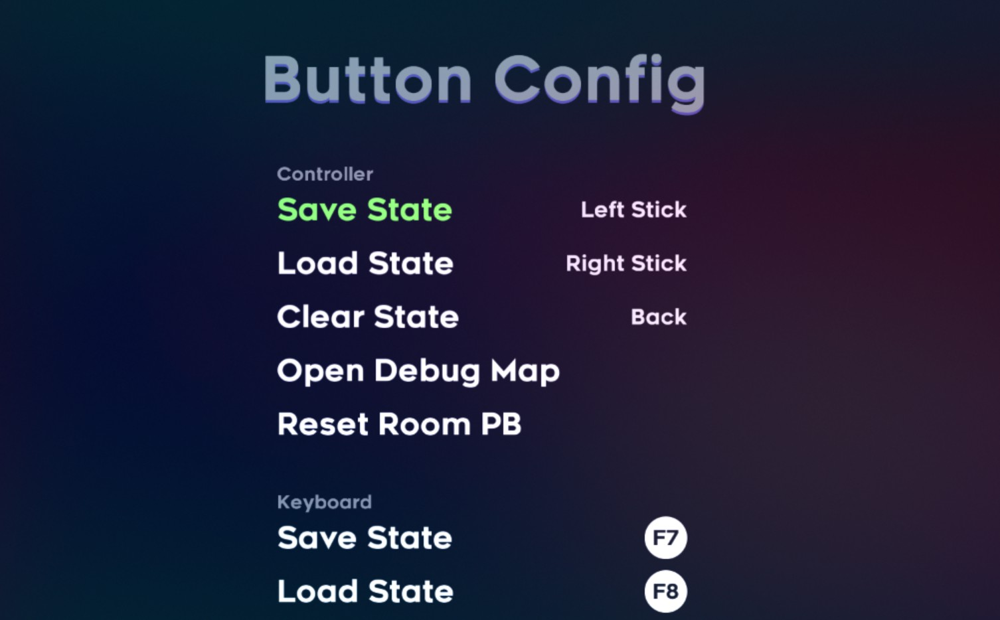

# Celeste Speedrun Tool

[中文说明](./README_CN.md)

## Download
[GameBanana](https://gamebanana.com/tools/6597)

## Features

- Create save states* to practice certain segments of the room, automatically loaded after death. Customizable keyboard/controller shortcut for saving and loading.
- Save states survive chapter changes: loading a state that was saved in another chapter (or from the chapter select, F8 works there too) automatically re-enters the chapter it was saved in and then restores it. The old "clear the state when leaving the chapter" behaviour is still available as **Auto Clear State on Chapter Transition (Legacy)** in the State settings (off by default). The option was hidden in older release builds, so v3.28.0 migrates an existing settings file once: a stored `On` value is treated as the old default and switched to `Off`; enable it again in the State settings if you really want the legacy behaviour.
- Room timer compatible with Summit flags. Personal best is recorded.
- Statistics on deaths, including location, time lost, etc.
- Controller support for debug map: use confirm to teleport, right analog to zoom.
- Debug mode F6 teleport bug-fix – Dream blocks and Badeline not activating in Old Site, incorrect ice/fire state in Core, Celestial Resort huge mess hall being strangely lit, wind sound does not play in Summit 2000m.

## Performance

A save state has to keep a deep copy of the room's object graph, so it is heavy by nature. Recent
versions keep that cost predictable and expose the main memory/speed trade-off:

- **Pre-clone for Faster Load** (State settings, default `Auto`): the object graph needed by the
  next load is prepared on a background thread, which makes loading noticeably faster but keeps a
  second copy of the saved entities in memory. `Auto` enables it only on machines with more than
  ~10 GB of RAM; on a low-memory machine keep it `Auto` or set it to `Off` to roughly halve the
  savestate footprint.
- Save-state thumbnails are stored as small textures (<= 480 px on the long edge), not as
  full-screen captures, and capture buffers are reused.
- Loading a state saved in another chapter first has to load that chapter (map data, tilesets,
  audio) before the state is restored, so it costs roughly one chapter load on top of a normal
  same-chapter load. If entering the chapter fails, the state is kept and the game returns to the
  chapter select instead of getting stuck.
- The existing "GC after Load State" / "GC after Clear State" options still control when the mod
  forces a collection; if you see a hitch while clearing or loading states, try turning them off.
- Diagnostics (opt-in, zero cost in the shipped build): a normal Release build compiles the
  profiler out completely (the call sites are erased, so there is nothing to pay for). To
  diagnose, build with `-p:SrtProfiling=true`, put an empty `srt-profile.flag` next to
  SpeedrunTool.dll (or set `SRT_PROFILE=1`), and log.txt will contain one `SRT_PROFILE ...`
  line per save/load with per-segment milliseconds, allocation and GC/heap numbers.

Other mods and tools can drive save states through the `SpeedrunTool.SaveLoad` ModInterop API
(`SaveState`, `LoadState`, `SaveStateTas`, `LoadStateTas`, `ClearState`, `SwitchSlot`, `IsSaved`).
Benchmark/automation-only knobs (`SetPreCloneEnabled`, `SetAllowSaveLoadWhenWaiting`) live in a
separate `SpeedrunTool.Bench` export, so the public mod-facing contract stays small.

## Building

The mod builds with the .NET SDK (no Visual Studio required). Point `CelestePrefix` at a Celeste
installation that has Everest and the referenced assemblies:

```bash
dotnet build -c Release -p:CelestePrefix="/path/to/Celeste"
# optional: deploy the built mod straight into the game
dotnet build -c Release -p:CelestePrefix="/path/to/Celeste" -p:DeployDir="/path/to/Celeste/Mods/SpeedrunTool"
```

A release zip (same layout the old `toZip.cmd` produced: `everest.yaml` + `SpeedrunTool.dll` at the
zip root plus `Dialog/` and `Graphics/`) is made explicitly, not on every build:

```bash
dotnet build -c Release -p:CelestePrefix="/path/to/Celeste" -p:PackageMod=true -p:SrtPackageVersion=3.28.0
# -> dist/SpeedrunTool-3.28.0.zip
```

The version in `everest.yaml` remains the single source of truth; `SrtPackageVersion` only names the
release asset. Use a CI step (on a tag) to call this, so a debug build can never produce a release zip.

## Previews





## Acknowledgments

- A huge shout-out to [Extremely OK Games, Ltd.](https://exok.com/) for designing [Celeste](http://www.celestegame.com/) , it has been my favorite platformer ever since.
- [Everest](https://everestapi.github.io/) – Celeste Mod Loader and modding API, making this Mod a reality.
- [Ahorn](https://github.com/CelestialCartographers/Ahorn) – Map maker and level editor, useful for identifying different entities in the game.
- [Power Up Audio](https://www.powerupaudio.com/) – Curated library of high-quality sound effects for games, used to acquire Celeste audio project
- [西瓜](https://space.bilibili.com/18705633), [buhbai](https://www.speedrun.com/user/buhbai), [Evansfight](https://www.speedrun.com/user/Evansfight), [Lev067](https://www.speedrun.com/user/Lev067), [sonicyellow](https://www.speedrun.com/user/sonicyellow), [nameguy](https://gamebanana.com/members/1653060) – Mod tester.
- [rjdimo](https://steamcommunity.com/id/rjdimo/) – Shameless self-promoting translator of this readme file.