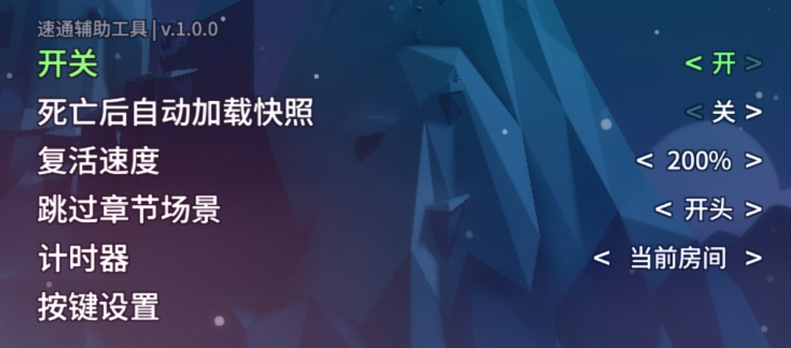
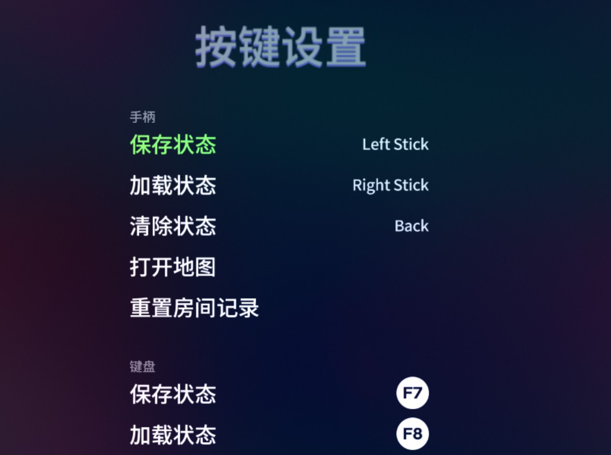

# Celeste 速通辅助工具

## 下载
[GameBanana](https://gamebanana.com/tools/6597)

## 功能
- 通过自定义的按键快速保存恢复状态
- 死亡时自动加载状态
- 状态会跨章节保留: 读档时如果存档是别的章节的, 会自动回到保存时的章节再恢复. State 设置里的 **章节切换时清除状态** 默认关闭, 开启后恢复旧的"离开章节就清档"行为. 旧版本的发布版菜单里不显示该项, 因此 v3.28.0 会对已有的设置文件做一次迁移: 存量的"开"值视为旧默认值, 自动改成"关"; 如果你确实想要旧行为, 可以在 State 设置里重新打开.
- 统计死亡数据，包括位置，损失的时间等
- 增加单个房间类型的计时器，支持记录最佳时间与第七章旗子间的计时
- 只用游戏手柄就也可以使用 Debug 地图，确认键选择房间，右摇杆缩放（已经整合到最新的 Everest 版本中）
- 修复游戏本身通过地图传送到 2A 的房间后无法激活梦幻方块和 Badeline 追逐战的问题
- 修复游戏本身通过地图传送到 3A 杂物大厅光线亮度不对的问题
- 修复游戏本身通过地图传送到第 7 章 2000m 后不播放风声的问题
- 修复游戏本身通过地图传送到第 8 章的房间后冰火状态不正确的问题

## Lua desync 保护

会捕获 Lua VM 执行状态（Lua 剧情、Lua Boss）的存档无法安全恢复: C# 侧回档了，全局 Lua VM 没有。
因此默认会拒绝这类存档。State 设置中只有一个开关:

- **允许不安全的 Lua 存档**: 跳过所有 Lua desync 检查, 包括 Lua 剧情和 Lua Boss. 在这些状态下
  保存的存档可能带着不一致的 Lua 状态读档; 除非接受这个风险, 否则保持关闭.

v3.28.0 的检查器还能发现数组/容器/泛型实参里嵌套的 Lua 值, 在 unskippable Lua talker 的协程
仍运行时拒绝存档, 并在 late check 清档时记录实体类型和字段路径.

## 性能说明

**低内存机器上不保证多槽性能。** 优化路径是单槽常驻：修复后的 8GB 测试机上帧 p99 约 30–32ms，
与 upstream LegacySupport 持平；3 槽会多出 GC 尾巴（修复后 phase-c p99 约 92ms，`gc_pause_ms` 每 20s 阶段约 1.0s）。
多槽仍然可用，槽位不会被自动清除，只是在 8GB 硬件上性能不保证。
存档本质上要保留整个房间对象图的深拷贝，因此开销天然较大。现在这些开销更可控，并且把主要的内存/速度取舍开放成了设置：
- **预克隆以加快读档**（State 设置，默认「开」）：在后台预先克隆下一次读档需要的对象图，读档明显更快，但存档会多保留一份实体图的内存。8GB 旧机实测只多用几十 MB，读档时间却大约减半；如果确实想省内存，请手动选「关」。
- **每局第一次进入章节的读图时间会多约 1.4 秒**（v3.29.1）：在读图阶段做一次专用预热存档，之后第一次真实存档不再有明显冷启动卡顿。不想多等读图可在 mod 设置文件里设 `WarmUpFirstSave: false`。
- 存档缩略图改为小尺寸纹理（长边 ≤ 480px，不再是整屏截图），捕获用的缓冲区也会复用。
- 读取别的章节的存档时，需要先把那个章节加载出来（map、tileset、音频），再恢复状态，所以会比同章节读档多花大约一次章节加载的时间；如果进章节失败，存档会保留、游戏回到章节选择界面，不会卡死。
- 原有的「加载存档后回收内存」「清除存档后回收内存」仍然控制强制 GC 的时机；如果清除/读取存档时出现卡顿，可以试着关掉它们。
- 诊断（可选，正式构建里零开销）：普通 Release 构建会把 profiler 完全编译掉（调用点被消除，没有任何运行时开销）。需要诊断时用 `-p:SrtProfiling=true` 构建，在 SpeedrunTool.dll 旁放一个空的 `srt-profile.flag`（或设环境变量 `SRT_PROFILE=1`），log.txt 里每次 save/load 就会多一行 `SRT_PROFILE ...`，包含分阶段耗时、分配量和 GC/堆信息。

其它模组/工具可以通过 `SpeedrunTool.SaveLoad` 这组 ModInterop API 驱动存档与读档（`SaveState`、`LoadState`、`SaveStateTas`、`LoadStateTas`、`ClearState`、`SwitchSlot`、`IsSaved`）；benchmark/自动化专用的开关（`SetPreCloneEnabled`、`SetAllowSaveLoadWhenWaiting`）单独放在 `SpeedrunTool.Bench` 这组 export 里，公开给 mod 的契约保持精简。

## 构建

用 .NET SDK 即可构建（不需要 Visual Studio）。`CelestePrefix` 指向装有 Everest 和引用程序集的 Celeste：

```bash
dotnet build -c Release -p:CelestePrefix="/path/to/Celeste"
# 可选：直接部署到游戏
dotnet build -c Release -p:CelestePrefix="/path/to/Celeste" -p:DeployDir="/path/to/Celeste/Mods/SpeedrunTool"
```

发布用 zip（和旧 `toZip.cmd` 相同布局：zip 根目录 `everest.yaml` + `SpeedrunTool.dll`，外加 `Dialog/`、`Graphics/`）是**显式**动作，不会每次 build 都生成：

```bash
dotnet build -c Release -p:CelestePrefix="/path/to/Celeste" -p:PackageMod=true -p:SrtPackageVersion=3.29.1
# -> dist/SpeedrunTool-3.29.1.zip
```

版本号仍以 `everest.yaml` 为准，`SrtPackageVersion` 只用于命名发布包；建议在 CI 的 tag 流程里调用，避免调试构建产出发布 zip。

## 预览





## 致谢
- [DemoJameson](https://github.com/DemoJameson) —— SpeedrunTool 的初代作者与前维护者，感谢他打下的基础。
- [Extremely OK Games, Ltd.](https://exok.com/) —— 感谢他们开发出了 [Celeste](http://www.celestegame.com/) 这款我最爱的平台跳跃游戏
- [Everest](https://everestapi.github.io/) —— Celeste Mod 加载器，没有它就没有这个 Mod
- [Ahorn](https://github.com/CelestialCartographers/Ahorn) —— 用来查找物体在游戏代码里的命名
- [Power Up Audio](https://www.powerupaudio.com/) —— 提供了 Celeste 的音频工程，处理音频时可以预先试听
- [西瓜](https://space.bilibili.com/18705633), [buhbai](https://www.speedrun.com/user/buhbai), [Evansfight](https://www.speedrun.com/user/Evansfight), [Lev067](https://www.speedrun.com/user/Lev067), [sonicyellow](https://www.speedrun.com/user/sonicyellow) — 测试与反馈
- [rjdimo](https://space.bilibili.com/11670105) —— 上门推销将本说明翻译成了英文
